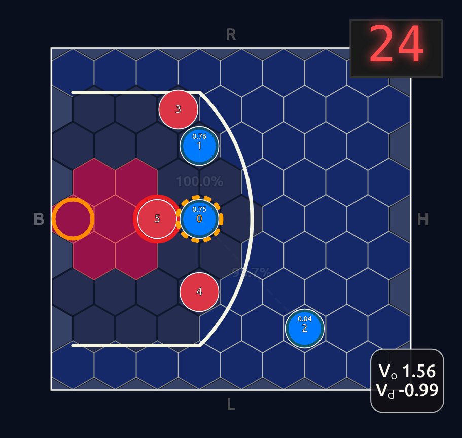
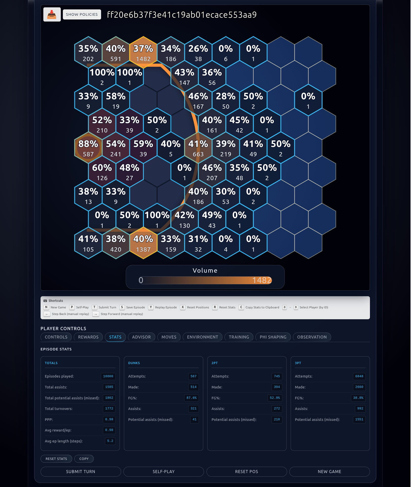

# BasketWorld

BasketWorld is a JAX half-court basketball environment for self-play reinforcement learning. The supported stack uses a batched JAX environment, Flax actor-critic models, an explicit PPO loop, Optax updates, Orbax checkpoints, and MLflow experiment tracking. The FastAPI and Vue applications use the same JAX runtime for evaluation, analysis, self-play, and interactive games.




## Supported stack

- `basketworld_jax/env/`: reset, transition, action masks, observations, rules, clocks, rebounds, inbounds, and check restarts.
- `basketworld_jax/models/`: Flax policy/value models, attention, pointer passing, intent embeddings, and selector heads.
- `basketworld_jax/train/`: CLI configuration, compiled rollout collection, PPO updates, schedules, checkpointing, and MLflow logging.
- `basketworld_jax/eval/`: native JAX evaluation, historical opponents, fixed player pools, and Skill Ratings studies.
- `basketworld_jax/inference/`: JAX checkpoint loading and inference.
- `app/backend/`: JAX-only FastAPI runtime and MLflow artifact selection.
- `app/frontend/`: interactive play, evaluation, policy inspection, playbook analysis, and media export.
- `app/training_backend/` and `app/training_frontend/`: trainer service and UI.

JAX checkpoint directories containing `metadata.json` and `state/` are the only supported checkpoint format. Historical SB3/PyTorch artifacts may remain in external storage, but BasketWorld does not load them. Historical architecture documents are retained as design records only.

## Setup

Python 3.11 or newer is required.

```bash
python -m venv .venv
source .venv/bin/activate
pip install -r requirements.txt
```

Start local MLflow:

```bash
./start_mlflow.sh --disable-s3
```

## Train

The trainer CLI is owned by the JAX package:

```bash
python -m basketworld_jax.train.main \
  --players 5 \
  --court-rows 16 \
  --court-cols 16 \
  --kernel-batch-size 256 \
  --rollout-horizon 128 \
  --num-updates 1000 \
  --enable-multi-possession \
  --episode-end-mode game_clock \
  --game-clock-seconds 300 \
  --overtime-seconds 120
```

Use `python -m basketworld_jax.train.main --help` for the full configuration. Training writes Orbax state and metadata beneath MLflow `models/` artifacts.

## Applications

Start the gameplay and evaluation backend:

```bash
uvicorn app.backend.main:app --host 0.0.0.0 --port 8080 --reload
```

Start the gameplay frontend:

```bash
cd app/frontend
npm install
echo "VITE_API_BASE_URL=http://localhost:8080" > .env
npm run dev
```

The trainer application has its own frontend in `app/training_frontend` and can be started with `scripts/start_training_app.sh`.

## Tests and documentation

```bash
pytest

pip install -r requirements-docs.txt
mkdocs build --strict
mkdocs serve
```

The curated documentation starts at `docs/site/index.md`. Current behavior is defined by the JAX source and tests; plans under `docs/` and `readmes/` may describe historical development decisions.
