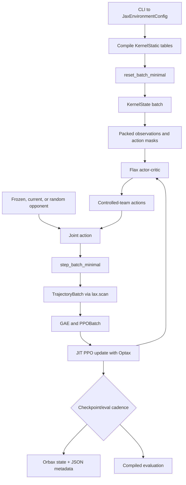

# JAX architecture

The JAX stack moves the rollout-critical environment, action selection, and PPO
update into array programs with stable shapes. Python remains the outer
orchestrator for CLI configuration, MLflow, checkpoint selection, and
human-readable summaries.

## Package map

| Package | Responsibility |
|---|---|
| `basketworld_jax/env/minimal.py` | Batched reset, transition, masks, observations, rules, and rewards |
| `basketworld_jax/models/actor_critic.py` | Flax MLP and attention actor-critic |
| `basketworld_jax/train/types.py` | Trajectory, PPO, selector, and evaluation containers |
| `basketworld_jax/train/runtime.py` | Compiled rollout, update, selector, and evaluation runners |
| `basketworld_jax/train/main.py` | CLI, schedules, self-play orchestration, metrics, and checkpoint cadence |
| `basketworld_jax/intent/discriminator.py` | Intent discriminator, bonuses, and sample diagnostics |
| `basketworld_jax/checkpoints/checkpoint.py` | Orbax state and JSON metadata serialization |
| `basketworld_jax/eval/native.py` | Batched JAX-native evaluation and aggregation |

## End-to-end data flow

## Array-oriented environment

`step_batch_minimal` uses `jax.vmap` over one pure single-state transition.
The rollout runner uses `jax.lax.scan` over the configured horizon. The entire
runner is JIT compiled with horizon as a static argument.

This composition provides:

- one compiled transition program for a batch of possessions;
- explicit PRNG keys for every stochastic decision;
- no Python environment loop inside rollout collection;
- predictable trajectory shapes for PPO.

Terminal rows can be reset inside the scan and continue producing samples.
When single-episode mode is enabled, they remain inactive and their later
trajectory entries are masked.

## Configuration and reset

The trainer converts CLI values into `JaxEnvironmentConfig`, constructs court
geometry and rule tables with `build_kernel_static_from_config`, and creates
the initial state batch with `reset_batch_minimal`. Possession and game-clock
training use this same seeded path. No Gym environment, SB3 vector wrapper, or
Python state snapshot participates in supported JAX training construction.

The configuration contract also supplies checkpoint and MLflow metadata, so a
training run records the same canonical settings used to build its static and
initial state.

Timed training specializes its compiled runners on `game_clock` and carries a
game across fixed PPO rollout boundaries. Its budget observation is seconds
remaining divided by 720, and its relative-score observation is the observing
team's score difference divided by 30; neither value is clipped. A total-step
safety truncation is reported separately and bootstraps from the final state
before the environment resets. Native and historical timed evaluation run the
same JAX clock kernel, keep safety and horizon truncations separate, and exclude
both from completed-game outcome rates.

Training metrics preserve raw period and clock coordinates and report completed
possessions per game, per-team offensive efficiency and pace, mean clock time per
possession, regulation/overtime counts, terminal clock values, regulation
quarter-segment scoring, overtime scoring, and safety truncations separately.
The native and historical summaries use those same definitions: points per
completed offensive possession for efficiency, completed offensive possessions
per elapsed game-clock minute for pace, and elapsed game-clock seconds per
completed possession for duration. Zero denominators produce `0.0`. Evaluation
artifacts also retain compact scoring and possession events with their period
and pre-step clock timestamp, plus separate summaries for completed and
truncated games.

## Rollout variants

The runtime builds distinct compiled runners for:

- same-policy/current-policy collection;
- one frozen opponent;
- grouped frozen opponents;
- training evaluation;
- fixed-seed deploy-style evaluation.

They share environment and policy primitives. The variants differ mainly in
how opponent parameters and deterministic-versus-sampled actions are supplied.

## Explicit orchestration

Unlike an SB3 algorithm object, the outer loop makes stages visible:

1. compute schedules for the update;
2. collect offense and defense rollouts;
3. update optional intent discriminators and reward bonuses;
4. build and concatenate PPO batches;
5. update actor-critic parameters;
6. update selector-only parameters when scheduled;
7. summarize and log metrics;
8. evaluate and checkpoint at configured intervals.

This explicitness is useful for research: task reward, shaping, intent bonus,
opponent selection, and update timing are separately observable.

## Shape stability

JAX compilation is specialized to shapes and static choices. Important
shape-bearing settings include:

- player count;
- court geometry and cell count;
- kernel batch size;
- rollout horizon;
- observation family;
- policy architecture;
- action-head mode;
- PPO batch size and minibatch count;
- opponent group count.

Changing one can trigger compilation. The runtime also rejects calling a
compiled PPO runner with a new batch size.
